<div align="center">

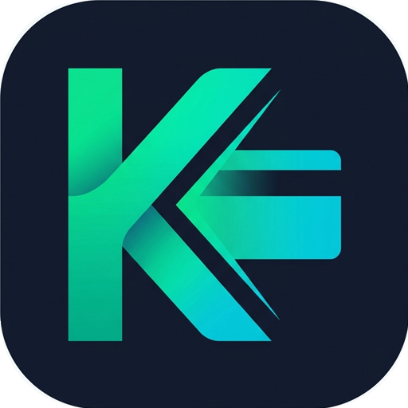

# ⚡ KasaNova POS — Yeni Nesil Hızlı Satış & Stok Yönetim Sistemi

**Perakende mağazalar, marketler, elektronikçiler ve işletmeler için %100 Türkçe, çevrimdışı çalışabilen (Offline-First) satış noktası (POS), veresiye ve ön muhasebe sistemi.**

[](#)
[](#)
[](docker-compose.yml)
[](frontend/package.json)
[](backend/package.json)
[](backend/prisma)

<br />

[🚀 Hızlı Kurulum](#-hızlı-kurulum) •
[✨ Özellikler](#-öne-çıkan-özellikler) •
[📸 Ekran Görüntüleri](#-ekran-görüntüleri-ve-kullanım-rehberi) •
[🏗️ Mimari](#️-sistem-mimarisi) •
[🖨️ Donanım & Yazıcı](#️-donanım-ve-yazıcı-desteği) •
[🛠️ Geliştirici Kurulumu](#️-yerel-geliştirme-docker-olmadan--nodejs-ile)

<br />


</div>

---

## 🌟 Neden KasaNova POS?

**KasaNova POS**, küçük ve orta ölçekli işletmelerin aylık abonelik ücretlerine veya internet bağlantısına bağımlı kalmadan kendi bilgisayarlarında ya da sunucularında çalıştırabileceği modern bir **Hızlı Satış (POS), Stok, Veresiye ve Fatura Yönetim** platformudur.

> [!TIP]
> **İnternet Kesilse Bile Kasalarınız Durmaz!**
> Sistem doğrudan mağazanızdaki bilgisayarda (veya yerel ağda) çalışır. Barkod okutma, satış yapma, 80mm termal fiş ve A4 fatura yazdırma işlemleri internet bağlantısı olmadan **sıfır gecikmeyle** gerçekleşir.

### 🎯 Kimler İçin Uygun?

| Sektör / İşletme | Sağladığı Avantajlar |
| :--- | :--- |
| 🏪 **Market, Büfe & Şarküteri** | Hızlı barkod okuma, terazili/gramajlı ürün satışı, para üstü hesabı, veresiye defteri |
| 📱 **Telefon, Bilgisayar & Elektronik** | Satış anında **IMEI / Seri Numarası** kaydı, otomatik **Garanti Belgesi** ve sorgulama |
| 👗 **Butik, Kırtasiye & Hırdavat** | Barkodu olmayan ürünlere tek tıkla **EAN-13 Barkod & QR Etiketi** üretme ve yazdırma |
| 📦 **E-Ticaret Yapan Mağazalar** | **WooCommerce, Shopify** ve özel site entegrasyonu ile Mağazadan Teslim (Click & Collect) panosu |

---

## ✨ Öne Çıkan Özellikler

<table>
  <tr>
    <td width="50%" valign="top">
      <h3>⚡ Hızlı Kasa & Barkod Sistemi</h3>
      <ul>
        <li><b>Barkod Odaklı Kasa:</b> Ürünü okutun sepete eklensin, tekrar okutun adedi artsın, <code>Enter</code> ile satışı tamamlayın.</li>
        <li><b>Kamera ile Okuma:</b> USB barkod okuyucunuz yoksa telefon veya tablet kamerasıyla barkod/QR okutun.</li>
        <li><b>Etiket Üretici:</b> Barkodsuz ürünler için sistem içinden geçerli <b>EAN-13</b> barkod ve fiyat etiketi oluşturup yazdırın.</li>
        <li><b>Müşteri Ekranı:</b> Kasadaki ikinci bir ekranı, tableti veya telefonu canlı müşteri ekranına dönüştürün.</li>
      </ul>
    </td>
    <td width="50%" valign="top">
      <h3>🧾 KDV, Fiş & A4 Fatura</h3>
      <ul>
        <li><b>%100 Türkçe Fiş & Fatura:</b> Nakit, Kredi/Banka Kartı, Havale/FAST (IBAN QR), Veresiye ve Parçalı Ödeme desteği.</li>
        <li><b>3 Farklı Yazdırma Modu:</b> Tarayıcıdan yazdırma, doğrudan <b>USB ESC/POS (80mm Termal)</b> yazdırma veya PDF indirme.</li>
        <li><b>A4 Vergi Faturası:</b> Kaşe/imza görseli, KDV dağılımı, ödeme QR kodu ve garanti tablosu içeren profesyonel A4 PDF.</li>
        <li><b>İade & Değişim:</b> Fiş numarasıyla geçmiş satışı bulup kısmi veya tam iade/değişim yapma, mağaza bakiyesi tanımlama.</li>
      </ul>
    </td>
  </tr>
  <tr>
    <td width="50%" valign="top">
      <h3>📊 Stok, Tedarik & Varyant Takibi</h3>
      <ul>
        <li><b>Kritik Stok Uyarıları:</b> Azalan ürünleri gösterge panelinde anında görün ve otomatik sipariş önerileri alın.</li>
        <li><b>Toplu Ürün Aktarımı:</b> <b>CSV ve Excel (XLSX)</b> dosyalarıyla binlerce ürünü saniyeler içinde içeri/dışarı aktarın.</li>
        <li><b>Tedarikçi & Satın Alma:</b> Tedarikçi kartları oluşturun, resmi <b>Satın Alma Siparişi (PO)</b> PDF'leri hazırlayın.</li>
        <li><b>IMEI / Seri No & Garanti:</b> Elektronik ürünlerde satış esnasında seri no girin, daha sonra garanti süresini sorgulayın.</li>
      </ul>
    </td>
    <td width="50%" valign="top">
      <h3>🤝 Müşteri, Veresiye & Raporlama</h3>
      <ul>
        <li><b>Veresiye (Açık Hesap) Takibi:</b> Müşterilere veresiye satış yapın, kısmi tahsilatları ve borç geçmişini takip edin.</li>
        <li><b>Sadakat Puanı Sistemi:</b> Alışverişlerden puan kazandırın, kasada tek tıkla indirim olarak kullandırın.</li>
        <li><b>Gelişmiş Analitik & Grafikler:</b> Günlük/saatlik ciro, brüt kâr marjı, kategori dağılımı ve en çok satan ürünler.</li>
        <li><b>Personel & Vardiya:</b> Yönetici ve Kasiyer rolleri, vardiya açılış/kapanış kasa mutabakatı.</li>
      </ul>
    </td>
  </tr>
</table>

---

## 🚀 Hızlı Kurulum

<div align="center">
  
</div>

KasaNova POS mağazanızdaki **tek bir bilgisayara** kurulur. Aynı Wi-Fi / yerel ağdaki tüm telefon, tablet ve diğer bilgisayarlar ekstra kurulum gerektirmeden tarayıcıdan **`http://<bilgisayar-ip>:1994`** adresine girerek sistemi kullanabilir.

### 🐳 Seçenek 1: Docker Compose ile Kurulum (Önerilen)

Bilgisayarınızda [Docker](https://www.docker.com/) yüklüyse aşağıdaki 3 komutla sistemi saniyeler içinde ayağa kaldırabilirsiniz:

```bash
# 1. Projeyi klonlayın
git clone https://github.com/ibrahimgenc27/kasanova-pos.git
cd kasanova-pos

# 2. Ortam değişkenleri dosyasını oluşturun
cp .env.example .env

# 3. Konteynerleri derleyip arka planda başlatın
docker compose up -d --build
```

Kurulum tamamlandığında tarayıcınızdan **[http://localhost:1994](http://localhost:1994)** adresini açın!

---

### 🛠️ Seçenek 2: Yerel Geliştirme (Docker Olmadan — Node.js ile)

Sistemi doğrudan **Node.js (v20+ / v24)** ile çalıştırmak veya geliştirmek isterseniz iki ayrı terminalde Backend ve Frontend servislerini başlatabilirsiniz:

#### 1️⃣ Backend (API & Veritabanı)

```powershell
cd backend
npm install

# Prisma istemcisini oluşturun ve SQLite veritabanı tablolarını hazırlayın
npx prisma generate
npx prisma migrate deploy

# Geliştirme sunucusunu başlatın (Varsayılan port: 4000)
npm run dev
```

#### 2️⃣ Frontend (Next.js Arayüzü)

```powershell
cd frontend
npm install

# Arayüzü 1994 portunda başlatın
npm run dev
```

Ardından tarayıcınızda **[http://localhost:1994](http://localhost:1994)** adresine gidin.

---

## 📸 Ekran Görüntüleri ve Kullanım Rehberi

### 1️⃣ Gösterge Paneli (Dashboard) ve İlk Kurulum
İlk açılışta yönetici hesabınızı, mağaza bilgilerinizi, para birimini (`₺ TRY`) ve KDV ayarlarınızı belirleyin. Gösterge panelinden günlük ciroyu, stok uyarılarını ve en çok satanları anlık takip edin.

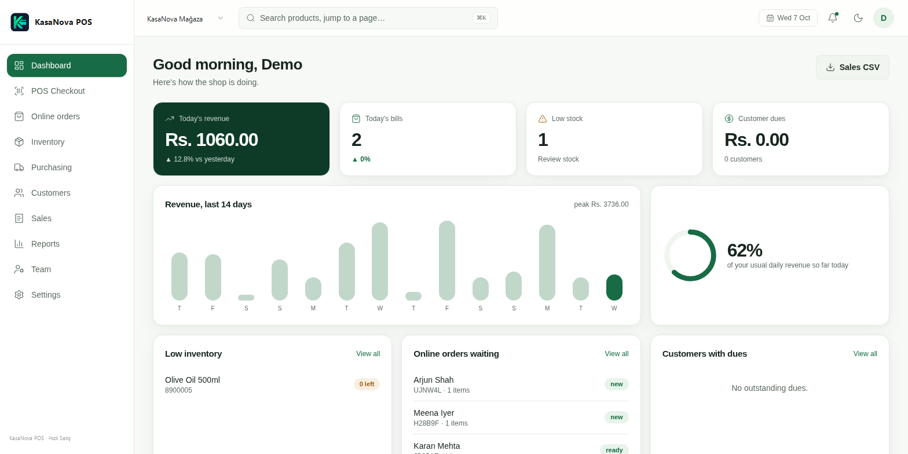

---

### 2️⃣ Stok Yönetimi ve Ürün Ekleme
**Stok → Ürün Ekle** ekranından ürün adı, alış/satış fiyatı, stok adedi ve kritik stok seviyesini girin. Barkodu okutabilir veya **Üret (Generate)** butonuyla otomatik barkod oluşturabilirsiniz.

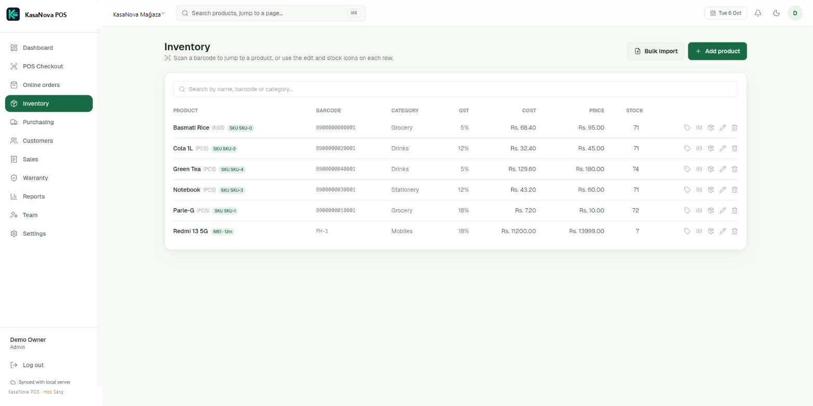

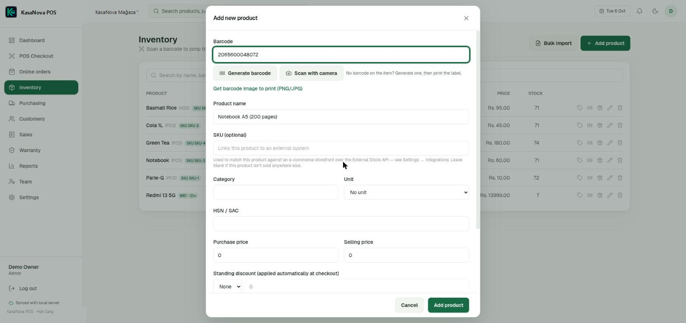

---

### 3️⃣ Hızlı Satış (POS Kasa) ve IMEI/Garanti Takibi
**POS Kasa** ekranında barkod okutarak veya ürün arayarak sepeti oluşturun. Müşteri seçin, ödeme yöntemini (Nakit, Kart, Havale/FAST, Veresiye) belirleyin ve satışı tamamlayıp fişinizi yazdırın.

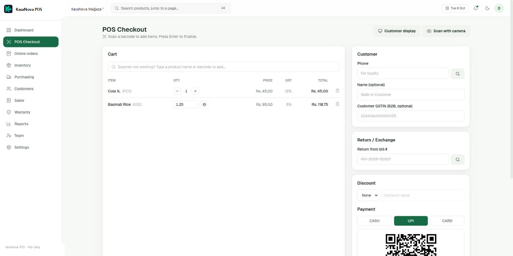

> [!NOTE]
> Telefon, bilgisayar veya beyaz eşya satıyorsanız **Ayarlar → Özellikler** altından **IMEI / Seri Numarası ve Garanti** takibini açabilirsiniz. Satış sırasında her ürün için seri numarası sorulur ve faturaya garanti süresiyle birlikte basılır.

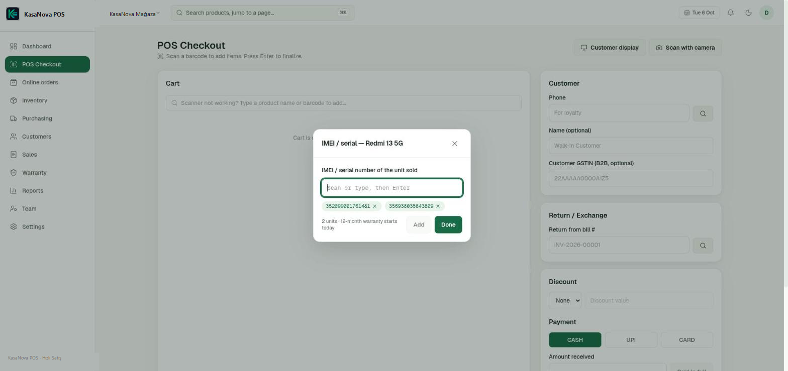

---

### 4️⃣ Online Siparişler (E-Ticaret Entegrasyonu)
WooCommerce, Shopify veya kendi özel e-ticaret sitenizden gelen siparişleri **Yeni → Hazırlanıyor → Hazır → Teslim Edildi** panosunda yönetin.

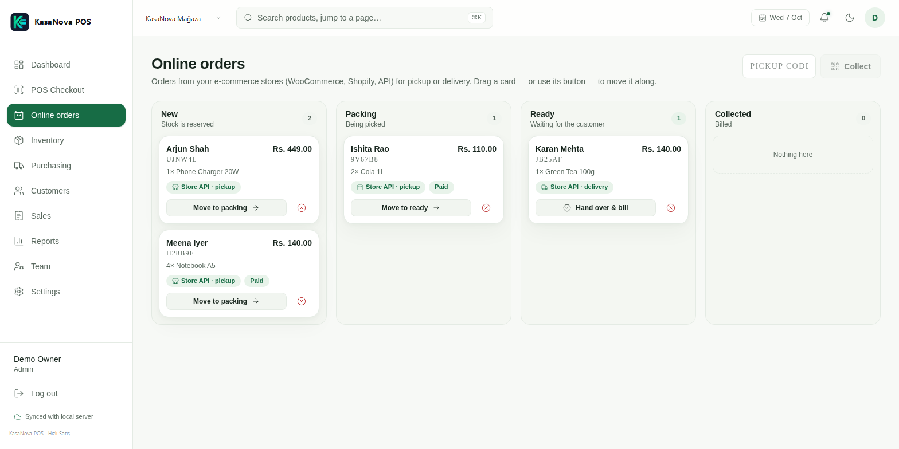

---

### 5️⃣ Raporlar, A4 Fatura ve Garanti Sorgulama
7, 30 veya 90 günlük periyotlarla ciro, kâr marjı, kategori dağılımı ve saatlik satış yoğunluğunu inceleyin; muhasebeniz için tek tıkla CSV/Excel çıktısı alın.

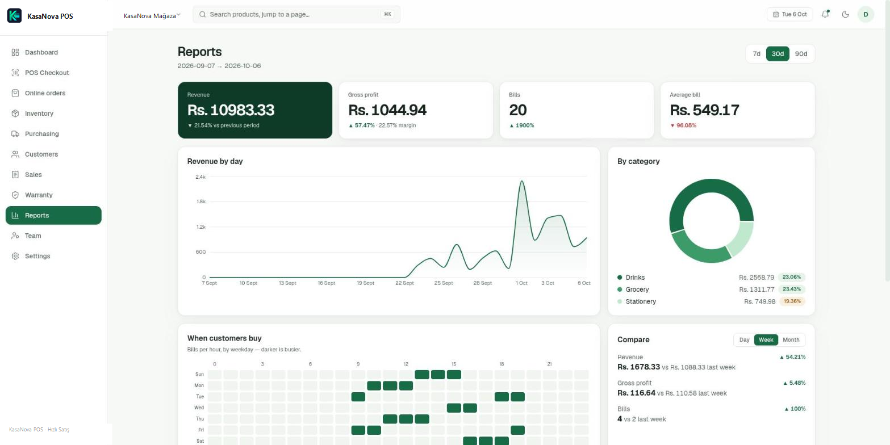

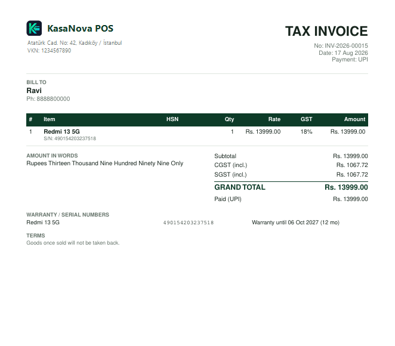

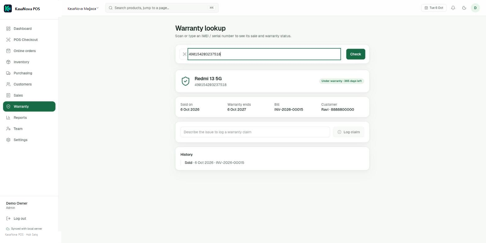

---

## 🏗️ Sistem Mimarisi

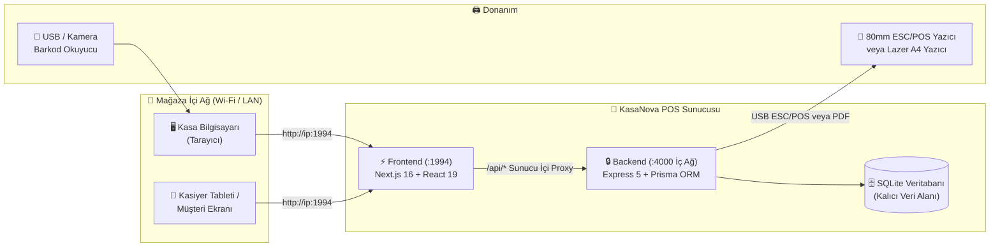

- **Tek Port, Tam Güvenlik:** Tarayıcılar yalnızca `1994` portundaki Next.js sunucusuyla konuşur. Tüm `/api/*` istekleri sunucu tarafında dahili ağ üzerinden Backend'e iletilir; API dış ağa doğrudan açılmaz.
- **Sıfır Dış Bağımlılık:** Barkod üretimi (`jsbarcode`), QR kod oluşturma (`qrcode`), PDF fatura çizimi (`pdfkit`) ve grafikler (`recharts`) tamamen yerel olarak çalışır.

---

## 🛠️ Teknoloji Yığını (Tech Stack)

| Katman | Kullanılan Teknolojiler |
| :--- | :--- |
| **Frontend (Önyüz)** |     |
| **Backend (Arkayüz)** |    |
| **Veritabanı & ORM** |   (`better-sqlite3` adaptörü ile yüksek performans) |
| **Güvenlik & Yetki** | `bcryptjs` şifreleme, `HttpOnly` JWT çerezleri, `helmet`, `express-rate-limit`, Yönetici/Kasiyer rolleri |
| **Yazdırma & Barkod** | `pdfkit` (A4 & Fiş PDF), Doğrudan USB `ESC/POS` sürücüsü, `jsbarcode` (EAN-13/CODE128), `@zxing/browser` kamera okuyucu |

---

## 🖨️ Donanım ve Yazıcı Desteği

- **Barkod Okuyucular:** Klavye emülasyonlu (HID) tüm kablolu/kablosuz USB veya Bluetooth 1D/2D barkod okuyucular **tak-çalıştır** olarak desteklenir.
- **Termal Fiş Yazıcıları (80mm / 58mm):**
  - **Tarayıcı Üzerinden:** Bilgisayarınıza tanıtılmış herhangi bir termal veya A4 yazıcıdan doğrudan çıktı alabilirsiniz.
  - **Doğrudan USB (ESC/POS):** Yazdırma penceresi açılmadan tek tıkla anında fiş kesmek ve para çekmecesini (`RJ11`) tetiklemek için USB üzerinden ham ESC/POS komutu gönderilebilir.

---

## 📁 Proje Dizin Yapısı

```text
kasanova-pos/
├── backend/                  # Express 5 API, Prisma şeması ve PDF/Fiş motoru
│   ├── prisma/               # SQLite veritabanı şeması ve migrasyonlar
│   └── src/
│       ├── lib/              # Fiş (receipt.js), A4 Fatura (pdfInvoice.js), ESC/POS (escposReceipt.js)
│       └── routes/           # Satış, Stok, Müşteri, Rapor ve Ayar API uç noktaları
├── frontend/                 # Next.js 16 (App Router) Türkçe kullanıcı arayüzü
│   ├── app/                  # Sayfalar (POS, Stok, Satışlar, Raporlar, Ayarlar, Garanti)
│   └── components/           # Yeniden kullanılabilir UI bileşenleri ve Recharts grafikleri
├── updater/                  # Docker kurulumları için tek tıkla güncelleme servisi
├── docs/                     # Dokümantasyon, ekran görüntüleri ve animasyonlu SVG'ler
└── docker-compose.yml        # Tek komutla tam kurulum yapılandırması
```

<div align="center">
  <br />
  <b>⭐ Projeyi beğendiyseniz sağ üstten Star (Yıldız) vermeyi unutmayın! ⭐</b>
</div>
